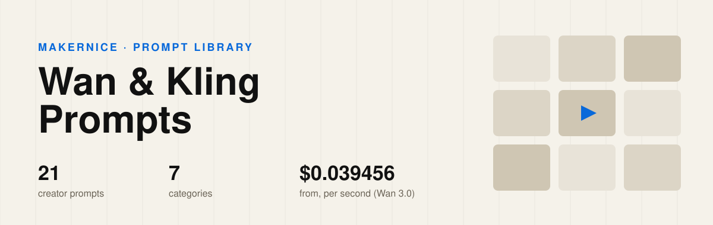

<p align="center"></p>

<h1 align="center">Awesome Wan &amp; Kling Prompts</h1>

<p align="center"><b>21 Wan and Kling video prompts, hand-picked from creators on X</b> — not scraped. Every clip was watched and every prompt checked against the creator's own post,<br>each one credited and one click away from a rerun on Makernice with the price shown first.</p>

<p align="center">
<a href="#-browse-by-category"></a>
<a href="#-browse-by-category"></a>

<a href="https://makernice.com/models/wan-3-0/?utm_source=github&utm_medium=prompts-repo&utm_campaign=awesome-wan-kling-prompts"></a>
<a href="#%EF%B8%8F-license--reuse"></a>
</p>

<p align="center"><b><a href="https://makernice.com/prompts/?utm_source=github&utm_medium=prompts-repo&utm_campaign=awesome-wan-kling-prompts">▶ Watch the clips with sound on Makernice</a></b> · <a href="https://github.com/makernice/awesome-seedance-2.5-prompts">Seedance 2.5 prompts</a> · <a href="https://github.com/makernice/awesome-minimax-h3-prompts">MiniMax H3 prompts</a></p>

## Contents

- [🗂️ Browse by category](#%EF%B8%8F-browse-by-category)
- [⭐ Featured](#-featured)
- [🔥 Most liked](#-most-liked)
- [🎬 Wan & Kling at a glance](#-wan--kling-at-a-glance)
- [💡 What these prompts teach](#-what-these-prompts-teach)
- [▶️ Run these prompts](#%EF%B8%8F-run-these-prompts)
- [✅ Why this list](#-why-this-list)
- [📊 Statistics](#-statistics)
- [🤝 How to contribute](#-how-to-contribute)
- [©️ Copyright & takedown notice](#%EF%B8%8F-copyright--takedown-notice)
- [⚖️ License & reuse](#%EF%B8%8F-license--reuse)
- [🙏 Acknowledgements](#-acknowledgements)
- [👤 Maintainer](#-maintainer)

## 🗂️ Browse by category

<table>
<tr><td width="33%" valign="top" align="center"><a href="prompts/action.md"></a><br><b>💥 <a href="prompts/action.md">Action &amp; Martial Arts</a></b><br><sub>6 prompts</sub></td><td width="33%" valign="top" align="center"><a href="prompts/fantasy-surreal.md"></a><br><b>🪐 <a href="prompts/fantasy-surreal.md">Fantasy &amp; Surreal</a></b><br><sub>6 prompts</sub></td><td width="33%" valign="top" align="center"><a href="prompts/product-ads.md"></a><br><b>🛍️ <a href="prompts/product-ads.md">Product (UGC &amp; Ads)</a></b><br><sub>4 prompts</sub></td></tr>
<tr><td width="33%" valign="top" align="center"><a href="prompts/anime.md"></a><br><b>🌸 <a href="prompts/anime.md">Anime</a></b><br><sub>2 prompts</sub></td><td width="33%" valign="top" align="center"><a href="prompts/vlog-daily-life.md"></a><br><b>📱 <a href="prompts/vlog-daily-life.md">Vlog &amp; Daily Life</a></b><br><sub>1 prompt</sub></td><td width="33%" valign="top" align="center"><a href="prompts/fashion-dance.md"></a><br><b>👗 <a href="prompts/fashion-dance.md">Fashion &amp; Dance</a></b><br><sub>1 prompt</sub></td></tr>
<tr><td width="33%" valign="top" align="center"><a href="prompts/travel-nature.md"></a><br><b>🏔️ <a href="prompts/travel-nature.md">Travel &amp; Nature</a></b><br><sub>1 prompt</sub></td></tr>
</table>

## ⭐ Featured

<table>
<tr><td width="33%" valign="top" align="center"><a href="prompts/anime.md#user-content-p-2112051914213032430"></a><br><b><a href="prompts/anime.md#user-content-p-2112051914213032430">Flame Versus Lightning Bamboo Duel</a></b><br><sub>20 s · 16:9 · <a href="https://x.com/ZaraIrahh/status/2112051914213032430">@ZaraIrahh</a></sub></td><td width="33%" valign="top" align="center"><a href="prompts/action.md#user-content-p-2100809690850664865"></a><br><b><a href="prompts/action.md#user-content-p-2100809690850664865">Rival Street Gangs Clash in an Open-World Game Look</a></b><br><sub>30 s · 16:9 · <a href="https://x.com/Inshrah_ali_/status/2100809690850664865">@Inshrah_ali_</a></sub></td><td width="33%" valign="top" align="center"><a href="prompts/fantasy-surreal.md#user-content-p-2094658391369191894"></a><br><b><a href="prompts/fantasy-surreal.md#user-content-p-2094658391369191894">Girl Paints Flowers That Become Real</a></b><br><sub>30 s · 16:9 · <a href="https://x.com/NoOneIsHere2603/status/2094658391369191894">@NoOneIsHere2603</a></sub></td></tr>
<tr><td width="33%" valign="top" align="center"><a href="prompts/fantasy-surreal.md#user-content-p-2093639918031446064"></a><br><b><a href="prompts/fantasy-surreal.md#user-content-p-2093639918031446064">Floating Cathedral Warrior Versus Fallen Angel</a></b><br><sub>30 s · 16:9 · <a href="https://x.com/LudovicCreator/status/2093639918031446064">@LudovicCreator</a></sub></td><td width="33%" valign="top" align="center"><a href="prompts/fantasy-surreal.md#user-content-p-2095949652667298044"></a><br><b><a href="prompts/fantasy-surreal.md#user-content-p-2095949652667298044">Escape Pod Flees an Exploding Space Station</a></b><br><sub>15 s · 16:9 · <a href="https://x.com/AllaAisling/status/2095949652667298044">@AllaAisling</a></sub></td><td width="33%" valign="top" align="center"><a href="prompts/fantasy-surreal.md#user-content-p-2098153036682047774"></a><br><b><a href="prompts/fantasy-surreal.md#user-content-p-2098153036682047774">Mars Colony Vehicle Outruns a Collapsing Dome</a></b><br><sub>15 s · 16:9 · <a href="https://x.com/AllaAisling/status/2098153036682047774">@AllaAisling</a></sub></td></tr>
</table>

## 🔥 Most liked

Likes on the original X post, read on 2026-11-06.

| # | | Prompt | Category | Length | Creator | ♥ on X |
|---|---|---|---|---|---|---|
| 1 |  | [Strawberry Ice Cream Product Ad With Infographic Look](prompts/product-ads.md#user-content-p-2048303530902265949) | Product (UGC & Ads) | 8 s | [@Strength04_X](https://x.com/Strength04_X/status/2048303530902265949) | 318 |
| 2 |  | [Halloween Haunted Mansion Hook](prompts/fantasy-surreal.md#user-content-p-2112484546734346612) | Fantasy & Surreal | 15 s | [@iam_mian7](https://x.com/iam_mian7/status/2112484546734346612) | 314 |
| 3 |  | [Anime Ritual Dance Opens a Portal for a Spaceship](prompts/anime.md#user-content-p-2099278002534101053) | Anime | 30 s | [@aimikoda](https://x.com/aimikoda/status/2099278002534101053) | 276 |
| 4 |  | [Phone-Camera Brunch Vlog Take](prompts/vlog-daily-life.md#user-content-p-2111471573395755295) | Vlog & Daily Life | 30 s | [@minchoi](https://x.com/minchoi/status/2111471573395755295) | 266 |
| 5 |  | [Shadow-Puppet Scissor Battle in an Old Theater](prompts/fantasy-surreal.md#user-content-p-2092617578338504970) | Fantasy & Surreal | 15 s | [@FellMentKE](https://x.com/FellMentKE/status/2092617578338504970) | 179 |
| 6 |  | [Time-Lapse Life Cycle of a Rose Plant](prompts/travel-nature.md#user-content-p-2025210293844861026) | Travel & Nature | 10 s | [@ZaraIrahh](https://x.com/ZaraIrahh/status/2025210293844861026) | 174 |
| 7 |  | [Flame Versus Lightning Bamboo Duel](prompts/anime.md#user-content-p-2112051914213032430) | Anime | 20 s | [@ZaraIrahh](https://x.com/ZaraIrahh/status/2112051914213032430) | 166 |
| 8 |  | [Rival Street Gangs Clash in an Open-World Game Look](prompts/action.md#user-content-p-2100809690850664865) | Action & Martial Arts | 30 s | [@Inshrah_ali_](https://x.com/Inshrah_ali_/status/2100809690850664865) | 162 |
| 9 |  | [Web-Swinging Heroine Taxi Crash](prompts/action.md#user-content-p-2112176287750259004) | Action & Martial Arts | 10 s | [@ariaxawan](https://x.com/ariaxawan/status/2112176287750259004) | 157 |
| 10 |  | [Red Carpet Gala Arrival in Fast Two-Second Cuts](prompts/fashion-dance.md#user-content-p-2090136981112250653) | Fashion & Dance | 15 s | [@Diplomeme](https://x.com/Diplomeme/status/2090136981112250653) | 151 |

## 🎬 Wan & Kling at a glance

| Model on Makernice (price list v12) | Length per run | Price per second | Modes | Aspect ratios |
|---|---|---|---|---|
| Wan 3.0 | 2–30 s | 480p $0.039456 · 720p $0.078903 · 1080p $0.157805 | Text-to-video · Image-to-video · First and last frame · up to 10 reference images | adaptive, 16:9, 9:16, 1:1, 4:3, 3:4 |
| Kling 3.0 Pro | 3–15 s | 1080p $0.16128 | Text-to-video · Image-to-video · First and last frame | 9:16, 16:9, 1:1 |
| Kling 4.0 | 3–30 s | 720p $0.168 · 1080p $0.252 | Text-to-video · Image-to-video · First and last frame · up to 10 reference images | 16:9, 9:16, 1:1, 21:9 |
| Wan 3.0 Prime | 2–30 s | 480p $0.061715 · 720p $0.123429 · 1080p $0.246857 | Text-to-video · Image-to-video · First and last frame · up to 10 reference images | adaptive, 16:9, 9:16, 1:1, 4:3, 3:4 |
| Kling 3.0 4K | 3–15 s | 4K $0.514272 | Text-to-video | 9:16, 16:9, 1:1 |

Failed, timed-out or canceled-while-queued runs release the hold in full.

## 💡 What these prompts teach

- **Long clips are written in parts.** 10 of the 21 split the clip into numbered shots, scenes or time codes.
- **Name the camera.** 18 of the 21 say how the camera moves or where it sits.
- **Write the sound.** 8 of the 21 describe what you should hear.
- **Length is not quality.** These run from 242 to 5,444 characters.

## ▶️ Run these prompts

Every entry links to Makernice, where you can rerun it by API. Entries that are live on the site open the creator's clip, a shot-by-shot breakdown and a one-click rerun. From code, quote first (free, locked for 12 minutes), then create with the quote:

```bash
curl -s https://api.makernice.com/v1/generations/quote \
  -H "Authorization: Bearer $MAKERNICE_API_KEY" \
  -H "Content-Type: application/json" \
  -d '{"model":"wan-3.0","mode":"t2v","duration":10,"resolution":"720p","aspect_ratio":"16:9","prompt":"..."}'
```

## ✅ Why this list

**Hand-picked, not bulk-scraped.** Many prompt lists are collected by scripts. Every entry here was chosen by a person who watched the clip, from posts that drew strong saves and shares on X.

**Checked against the creator's own post.** Every prompt is copied from the creator's post or their own reply in the same thread, then read against the original. Prompts guessed from the video alone are not accepted.

**One click to rerun, price first.** Every entry opens on Makernice, where you can rerun it by API. The price is quoted before you pay, and failed runs are not charged.

## 📊 Statistics

| Metric | Value |
|---|---|
| Prompts in this repository | 21 |
| Unique creators | 13 |
| Categories | 7 |
| Multi-shot or time-coded prompts | 10 |
| Originals that use reference images | 3 |
| Median prompt length | 1,994 characters |
| Last updated | 2026-11-06 |

## 🤝 How to contribute

Found a Wan and Kling prompt that belongs here? Open an issue with the link to the creator's post. It goes through the same checks as every other entry: the creator's own text, real engagement and the content rules. This README and every page under `prompts/` are generated from `data/`; please do not edit them by hand.

## ©️ Copyright & takedown notice

This repository carries three kinds of material under three different terms.

**Code** (generator scripts and tooling) is released under the MIT License; see the `LICENSE` file. The MIT License covers the code only.

**Curation** (selection, organization, statistics and the summaries written by us) is licensed under [CC BY 4.0](https://creativecommons.org/licenses/by/4.0/). Reuse it with attribution to *Makernice*.

**Prompts and media** remain the copyright of their original creators. Prompt text, thumbnails and video links are quoted from publicly published posts for reference; every entry links back to its original post. Nothing here grants a license to the underlying prompt or media beyond what the original post allows.

**Takedown process.** If you are a rights holder and want an entry removed or corrected, open a GitHub issue with the entry's link and the original post, or email support@makernice.com. Requests are checked against the original post and handled within 3 business days; the entry is removed from `data/` and disappears from every generated file on the next update. Earlier commits in the Git history may still contain it.

## ⚖️ License & reuse

Code in this repository is open source under the MIT License: use it, modify it, build on it, keep the license notice. Curation is CC BY 4.0; prompts and media stay with their creators. Details above under [Copyright & takedown notice](#%EF%B8%8F-copyright--takedown-notice).

## 🙏 Acknowledgements

- **The creators** credited on every entry, for publishing their prompts in the open.
- [LearnPrompt/awesome-seedance](https://github.com/LearnPrompt/awesome-seedance) — source-checked entries, statistics and the three-term copyright notice.
- [ai-boost/awesome-image-video-prompts](https://github.com/ai-boost/awesome-image-video-prompts) — one data file per entry, folded prompts and category pages generated from data.
- [freestylefly/awesome-gpt-image-2](https://github.com/freestylefly/awesome-gpt-image-2) — category cover cards.

## 👤 Maintainer

Maintained by the Makernice Team · [Makernice](https://makernice.com/?utm_source=github&utm_medium=prompts-repo&utm_campaign=awesome-wan-kling-prompts) · support@makernice.com
